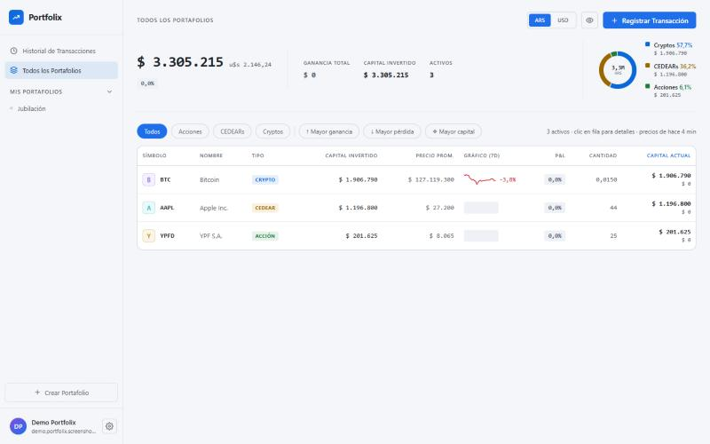
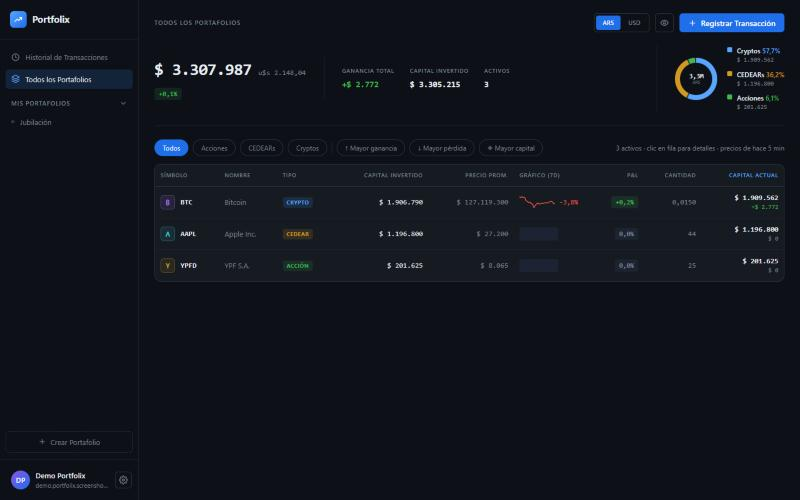
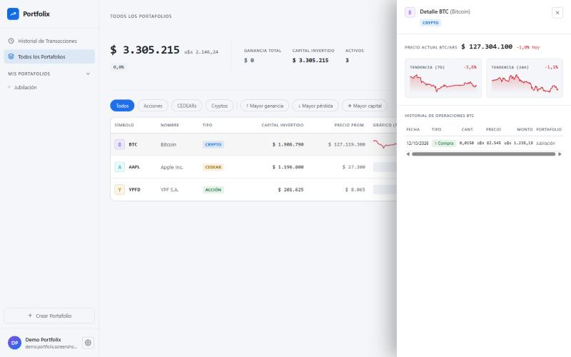
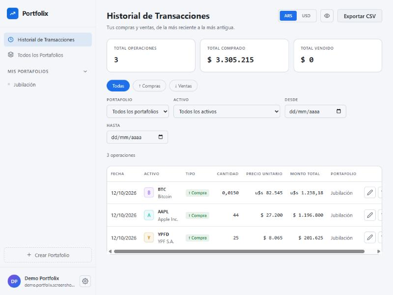
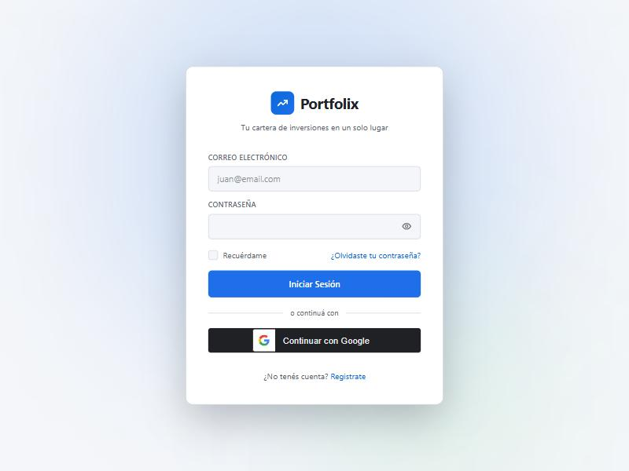
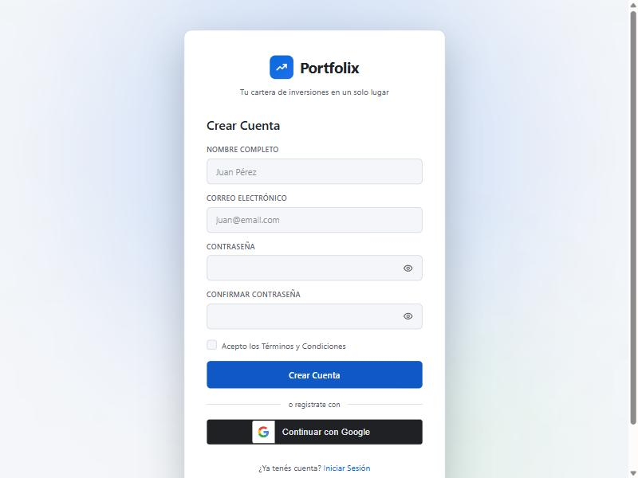

# Portfolix

[](https://github.com/zanzotteramateo/Portfolix/actions/workflows/backend-ci.yml)
[](https://github.com/zanzotteramateo/Portfolix/actions/workflows/frontend-ci.yml)
[](LICENSE)


App web para seguir una cartera de inversiones personal: **acciones argentinas, CEDEARs y criptomonedas**.
Registrás tus compras y ventas, las agrupás en portafolios ("Jubilación", "Ahorro Crypto"…) y ves cuánto vale
tu cartera hoy, cuánto ganaste o perdiste y cómo está repartida, en pesos o en dólares.

**🔗 Demo en vivo:** **https://portfolix-xt5h.onrender.com** ·
[documentación de la API (Swagger)](https://portfolix-xt5h.onrender.com/swagger-ui.html)

> Corre en el plan gratuito de Render: si nadie la visitó en los últimos 15 minutos, se duerme, así que la
> primera carga puede tardar ~1 minuto en responder (la base en Neon se reactiva sola). Después anda normal.

> **Estado:** proyecto completo y en producción — backend (API REST), front en React y deploy. Cuentas (registro
> con verificación por mail, login con Google, recuperación de contraseña y bloqueo por intentos), portafolios,
> historial de operaciones con edición y borrado, dashboard con precios en vivo, cuenta y preferencias, y tests
> end-to-end con Playwright.

## Capturas

<p align="center">
  
  
</p>
<p align="center">
  
  
</p>
<p align="center">
  
  
</p>

## Qué hace

- **Portafolios**: crear, renombrar, duplicar y eliminar (moviendo sus operaciones a otro portafolio o borrándolas).
- **Operaciones**: alta, edición y borrado de compras y ventas, con historial filtrable y totales.
  Una venta nunca puede superar lo que tenías **en esa fecha**.
- **Dashboard**: valor actual, capital invertido, ganancia realizada y no realizada, distribución por tipo de activo
  y tendencia de 7 días de cada activo. En ARS o en USD (dólar blue).
- **Precios en vivo**: acciones y CEDEARs de BYMA, cripto y cotización del dólar, con historial de 24 h y 7 días.
- **Cuentas**: registro con verificación por mail, login con Google, recuperación de contraseña, bloqueo tras
  intentos fallidos y rate limit por IP.
- **Cuenta y preferencias**: cambio de mail y de contraseña, tema claro/oscuro, separador decimal, exportar el
  historial a CSV y eliminar la cuenta.

## Stack

**Backend:** Java 25 · Spring Boot 4.1 · Spring Security (JWT propios + OAuth2 Resource Server) · Spring Data JPA ·
PostgreSQL 17 · Flyway · Caffeine · Bucket4j · Thymeleaf (mails) · springdoc-openapi · JUnit 5 + Testcontainers

**Front:** React 19 · TypeScript · Vite · Redux Toolkit · React Router · React Hook Form · CSS Modules

**Infraestructura:** Docker · GitHub Actions · Dependabot · [Render](https://render.com) (hosting) ·
[Neon](https://neon.tech) (Postgres) · [Brevo](https://www.brevo.com) (mails)

## Decisiones de diseño

- **La tenencia nunca queda negativa, en ningún día.** Cada alta, edición o borrado arma el historial como quedaría
  y lo valida en orden cronológico. Si un cambio deja sin tenencia a una venta posterior, se rechaza y el mensaje
  dice cuál. Antes de validar se bloquea el portafolio (`SELECT … FOR UPDATE`), así dos operaciones simultáneas
  se validan de a una.
- **Sesiones seguras sin estado en el servidor.** Access token JWT de 15 minutos y refresh token rotativo en una
  cookie `HttpOnly`. Si alguien reusa un refresh token ya rotado (señal de robo), se cierran todas las sesiones.
  En la base solo se guardan hashes.
- **Precios que sobreviven a una API caída.** Las cotizaciones se cachean y se refrescan en segundo plano: si una
  fuente falla, se sigue mostrando el último valor conocido.
- **Ganancias en dos monedas, bien calculadas.** Precio promedio ponderado; cada operación se convierte con el dólar
  del día en que se hizo y la tenencia se valoriza con el de hoy.
- **Todo pertenece a un usuario.** Cada consulta filtra por el usuario autenticado, y un recurso ajeno responde 404
  (no 403), para no revelar que existe.
- **El front nunca guarda el token donde un script lo pueda leer.** El access token vive solo en memoria y, al
  recargar, se recupera con la cookie. Si llegan varios 401 juntos (o hay varias pestañas abiertas), comparten una
  sola renovación: dos renovaciones simultáneas parecerían un robo y el backend cerraría todas las sesiones.
- **Tests de verdad.** Unos 360 tests: unitarios de las reglas de cálculo y de integración contra un Postgres real
  (Testcontainers). Usan precios fijos, así que nunca salen a internet ni mandan mails.

## Arquitectura

API REST en capas (controller → service → repository), organizada por funcionalidad:

| Módulo | Qué contiene |
|---|---|
| `auth` | registro, login, Google, tokens de verificación y recuperación |
| `user`, `account` | datos del usuario, preferencias, cambio de mail y contraseña, eliminar cuenta, export CSV |
| `portfolio` | portafolios, duplicar y eliminar |
| `transaction` | operaciones y la validación de tenencia |
| `holding` | posiciones y dashboard (se calculan a partir de las operaciones) |
| `asset`, `market` | catálogo de 58 activos y precios en vivo |
| `common`, `security`, `config` | errores, mails, seguridad, caché |

Fuentes de mercado: [Data912](https://data912.com) (acciones y CEDEARs de BYMA), [CoinGecko](https://www.coingecko.com)
(cripto), [DolarApi](https://dolarapi.com) (dólar) y [ArgentinaDatos](https://argentinadatos.com) (dólar histórico).

En producción, el front (React) se compila y se empaqueta dentro del mismo jar del backend (ver `Dockerfile` en la
raíz), así los dos se sirven desde el mismo origen: la cookie del refresh token (`SameSite=Strict`) funciona sin
necesitar un dominio propio con subdominios `app.`/`api.`.

## Cómo correrlo

Requisitos: **JDK 25** y **Docker** (Docker Desktop en Windows o Mac).

```bash
cd portfolix-backend
./mvnw spring-boot:run
```

Así arranca con el perfil `dev` y levanta sola Postgres y [Mailpit](https://mailpit.axllent.org) (un servidor de mails
de prueba) con Docker Compose. Si la corrés desde el IDE, activá el perfil en la configuración de ejecución
(`SPRING_PROFILES_ACTIVE=dev`): sin perfil, la app usa la configuración de producción y no arranca sin sus variables.

- API: http://localhost:8080/api/v1
- Documentación interactiva (Swagger): http://localhost:8080/swagger-ui.html
- Mails enviados (verificación, recuperación): http://localhost:8025

Tests:

```bash
cd portfolix-backend
./mvnw test
```

### Front

Requisitos: **Node 24**. Con el backend corriendo:

```bash
cd portfolix-frontend
npm install
npm run dev
```

La app queda en http://localhost:5173. Vite le pasa al backend todo lo que va a `/api`, así que el navegador ve un
solo origen y la cookie de la sesión funciona sin configurar CORS.

### Imagen Docker (producción)

```bash
cd portfolix-backend
docker build -t portfolix-backend .
```

La imagen arranca con la configuración de producción y **no arranca si falta alguna variable obligatoria**:

| Variable | Para qué |
|---|---|
| `DB_HOST`, `DB_NAME`, `DB_USERNAME`, `DB_PASSWORD` (y `DB_PORT`, 5432 por defecto) | Postgres |
| `JWT_SECRET` | clave de firma de los tokens: Base64 de al menos 32 bytes (`openssl rand -base64 32`) |
| `MAIL_HOST`, `MAIL_FROM` (y `MAIL_PORT` 587, `MAIL_USERNAME`, `MAIL_PASSWORD`) | SMTP, con STARTTLS obligatorio |
| `FRONTEND_URL` | la URL del front, adonde apuntan los links de los mails |
| `CORS_ALLOWED_ORIGINS` (opcional) | los orígenes del front, si está en otro dominio |
| `GOOGLE_CLIENT_ID` (opcional) | el login con Google |

La JVM usa hasta el 75% de la memoria del contenedor; con un límite de 512 MB, la app ronda los 360 MB.

El deploy real (Render) compila front y backend juntos con el `Dockerfile` de la raíz del repo — ver "Arquitectura".

## Estructura del repo

```
Portfolix/
├── portfolix-backend/      API REST (Spring Boot)
├── portfolix-frontend/     front (React + Vite)
├── docs/screenshots/       capturas usadas en este README
├── Dockerfile              imagen combinada (front + backend) para el deploy en Render
└── .github/                CI (GitHub Actions) y Dependabot
```

## Licencia

[MIT](LICENSE).

---

Hecho por [@zanzotteramateo](https://github.com/zanzotteramateo).
